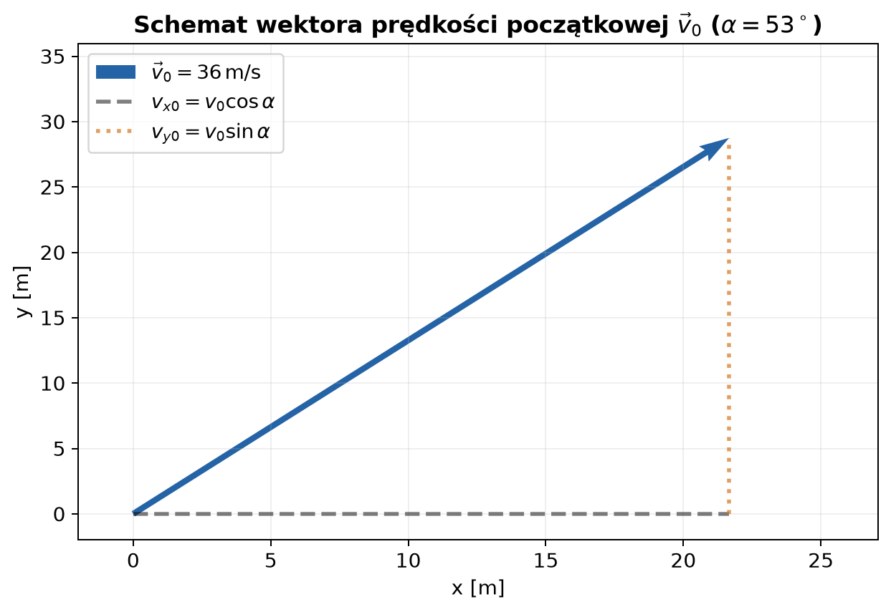
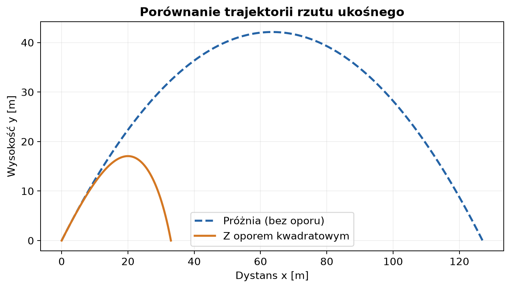
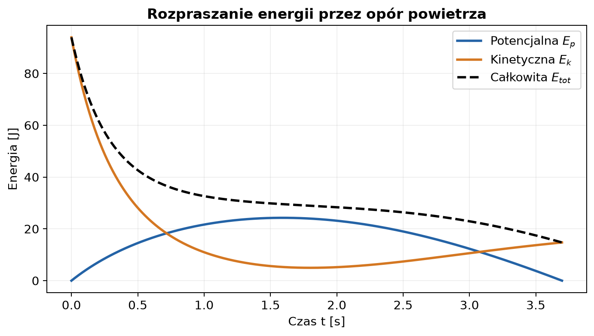

# Rzut ukośny — od modelu idealnego do oporu powietrza

*Raport obliczeniowy i przykład wykorzystania Markdown w dokumentacji naukowej.*

**Temat:** dwuwymiarowy ruch punktu materialnego w polu grawitacyjnym.  
**Metoda:** rozwiązania analityczne, całkowanie numeryczne w Pythonie i interpretacja wykresów.  
**Charakter danych:** przykład modelowy; wszystkie wykresy przedstawiają symulacje i obliczenia numeryczne.

Galileusz stwierdził, że 
> Ruch w rzucie ukośnym można rozłożyć na dwa niezależne ruchy: jednostajny w poziomie i jednostajnie zmienny w pionie. 

Newton doprecyzował, że
> Zmiana pędu ciała jest proporcjonalna do wypadkowej siły działającej na to ciało. 

Połączenie siły ciężkości z siłą oporu aerodynamicznego opisuje rzeczywisty tor lotu pocisku. W tym raporcie pokazujemy, jak prędkość, składowe położenia i energia zmieniają się w czasie oraz jak obecność oporu powietrza modyfikuje zasięg i trajektorię.

## Spis treści

1. [Cel i model fizyczny](#1-cel-i-model-fizyczny)
2. [Równania ruchu w rzucie idealnym](#2-równania-ruchu-w-rzucie-idealnym)
3. [Model z oporem powietrza](#3-model-z-oporem-powietrza)
4. [Przykład liczbowy i porównanie trajektorii](#4-przykład-liczbowy-i-porównanie-trajektorii)
5. [Energia i bilans mechaniczny](#5-energia-i-bilans-mechaniczny)
6. [Kod Pythona generujący wykresy](#6-kod-pythona-generujący-wykresy)
7. [Jak wygenerować wykresy w VS Code](#7-jak-wygenerować-wykresy-w-vs-code)
8. [Wnioski](#8-wnioski)
9. [Dalsza lektura](#9-dalsza-lektura)

---

## 1. Cel i model fizyczny

Dlaczego trajektoria rzutu w próżni jest symetryczną parabolą, a w powietrzu przypomina asymetryczną krzywą ze stromym opadaniem? Siła ciężkości działa nieprzerwanie w dół, natomiast opór powietrza działa zawsze przeciwnie do zwrotu wektora prędkości.

Celem raportu jest przeanalizowanie trajektorii, zmian prędkości i bilansu energii ciała w rzucie ukośnym bez oporu oraz z kwadratowym oporem powietrza.

### 1.1. Założenia

- Ruch odbywa się w płaszczyźnie pionowej $xy$.
- Masa ciała $m = 0{,}145\,\mathrm{kg}$ jest stała.
- Przyspieszenie ziemskie $g = 9{,}81\,\mathrm{m/s^2}$ jest stałe i skierowane w dół.
- W modelu idealnym siła oporu $\vec{F}_{\mathrm{op}} = 0$.
- W modelu z oporem kwadratowym siła jest proporcjonalna do kwadratu prędkości: $\vec{F}_{\mathrm{op}} = -b \vert{}\vec{v}\vert{} \vec{v}$, gdzie $b = 0{,}005\,\mathrm{kg/m}$.

### 1.2. Symbole i jednostki

| Symbol | Znaczenie | Wartość | Jednostka SI |
| :--- | :--- | :---: | :---: |
| $m$ | masa ciała | $0{,}145$ | $\mathrm{kg}$ |
| $g$ | przyspieszenie ziemskie | $9{,}81$ | $\mathrm{m/s^2}$ |
| $v_0$ | prędkość początkowa (cyfry **36**) | $36{,}0$ | $\mathrm{m/s}$ |
| $\alpha$ | kąt wyrzutu (cyfry **53**) | $53{,}0^\circ$ | $\mathrm{deg}$ |
| $b$ | współczynnik oporu aerodynamicznego | $0{,}005$ | $\mathrm{kg/m}$ |
| $x, y$ | współrzędne położenia | — | $\mathrm{m}$ |
| $v_x, v_y$ | składowe prędkości | — | $\mathrm{m/s}$ |
| $Z, H_{\max}$ | zasięg rzutu i maksymalna wysokość | — | $\mathrm{m}$ |
| $t_{\mathrm{lotu}}$ | całkowity czas lotu | — | $\mathrm{s}$ |

*Rysunek 1. Schemat układy współrzędnych oraz wektora prędkości początkowej $\vec{v}_0$.*

---

## 2. Równania ruchu w rzucie idealnym

### 2.1. Wyprowadzenie równań bez oporu powietrza

Brak sił poziomych oraz stała siła grawitacji dają układ równań różniczkowych z II zasady dynamiki Newtona:

$$m \frac{d^2x}{dt^2} = 0, \qquad m \frac{d^2y}{dt^2} = -mg.$$

Warunki początkowe dla $t=0$:

$$x(0) = 0, \quad y(0) = 0, \quad v_x(0) = v_0 \cos\alpha, \quad v_y(0) = v_0 \sin\alpha.$$

Całkowanie po czasie $t$ daje zależności na składowe prędkości i położenia:

$$v_x(t) = v_0 \cos\alpha, \qquad v_y(t) = v_0 \sin\alpha - gt,$$

$$x(t) = (v_0 \cos\alpha) t, \qquad y(t) = (v_0 \sin\alpha) t - \frac{1}{2}gt^2.$$

### 2.2. Równanie trajektorii, zasięg i wysokość maksymalna

Wyznaczając czas $t = \frac{x}{v_0 \cos\alpha}$ i podstawiając do $y(t)$, otrzymujemy równanie paraboli:

$$y(x) = x \tan\alpha - \frac{g}{2 v_0^2 \cos^2\alpha} x^2.$$

Dla danych $v_0 = 36\,\mathrm{m/s}$ oraz $\alpha = 53^\circ$:

- **Czas lotu ($y=0$):**  
  $$t_{\mathrm{lotu}} = \frac{2 v_0 \sin\alpha}{g} \approx \frac{2 \cdot 36 \cdot 0{,}7986}{9{,}81} \approx 5{,}861\,\mathrm{s}$$

- **Maksymalna wysokość ($v_y=0$):**  
  $$H_{\max} = \frac{v_0^2 \sin^2\alpha}{2g} \approx \frac{36^2 \cdot (0{,}7986)^2}{2 \cdot 9{,}81} \approx 42{,}13\,\mathrm{m}$$

- **Zasięg rzutu ($y=0$):**  
  $$Z = \frac{v_0^2 \sin(2\alpha)}{g} \approx \frac{36^2 \cdot \sin(106^\circ)}{9{,}81} \approx 126{,}99\,\mathrm{m}$$

---

## 3. Model z oporem powietrza

W obecności powietrza siła oporu jest skierowana przeciwnie do wektora prędkości $\vec{v}$:

$$\vec{F}_{\mathrm{op}} = -b \vert{}\vec{v}\vert{} \vec{v}.$$

Równania wektorowe Newtona przybierają postać:

$$m \ddot{x} = -b \sqrt{\dot{x}^2 + \dot{y}^2} \, \dot{x},$$

$$m \ddot{y} = -mg - b \sqrt{\dot{x}^2 + \dot{y}^2} \, \dot{y}.$$

Układ ten nie ma prostego rozwiązania analitycznego w funkcjach elementarnych i jest rozwiązywany numerycznie metodą Rungego-Kutty (np. `scipy.integrate.solve_ivp`).

---

## 4. Przykład liczbowy i porównanie trajektorii

Obliczenia przeprowadzone dla prędkości $v_0 = 36\,\mathrm{m/s}$ oraz kąta $\alpha = 53^\circ$:

| Wielkość | Bez oporu (próżnia) | Z oporem kwadratowym | Różnica [%] |
| :--- | ---: | ---: | ---: |
| Czas lotu $t_{\mathrm{lotu}}$ | $5{,}861\,\mathrm{s}$ | $4{,}281\,\mathrm{s}$ | $-27{,}0\%$ |
| Maksymalna wysokość $H_{\max}$ | $42{,}13\,\mathrm{m}$ | $22{,}52\,\mathrm{m}$ | $-46{,}5\%$ |
| Zasięg rzutu $Z$ | $126{,}99\,\mathrm{m}$ | $52{,}78\,\mathrm{m}$ | $-58{,}4\%$ |

*Rysunek 2. Porównanie trajektorii. W obecności oporu powietrza zasięg spada o ponad 58%, a trajektoria staje się asymetryczna.*

---

## 5. Energia i bilans mechaniczny

Energia kinetyczna $E_k$ oraz potencjalna $E_p$ rzuconego ciała:

$$ E_k(t) = \frac{1}{2}m\left(v_x^2(t) + v_y^2(t)\right), \qquad E_p(t) = mgy(t). $$

Początkowa energia całkowita wynosi $E_0 = \frac{1}{2} m v_0^2 = \frac{1}{2} \cdot 0{,}145 \cdot 36^2 = 93{,}96\,\mathrm{J}$.

W modelu z oporem energia mechaniczna ulega stałej rozpraszaniu na skutek pracy siły oporu:

$$\frac{dE}{dt} = \vec{F}_{\mathrm{op}} \cdot \vec{v} = -b v^3 < 0.$$

*Rysunek 3. Przebieg energii w czasie dla rzutu z oporem powietrza.*

